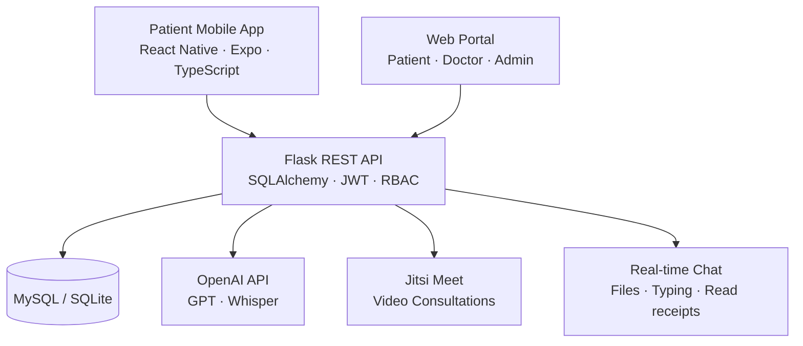
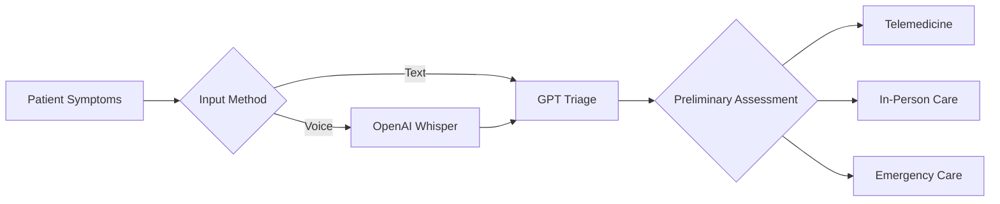
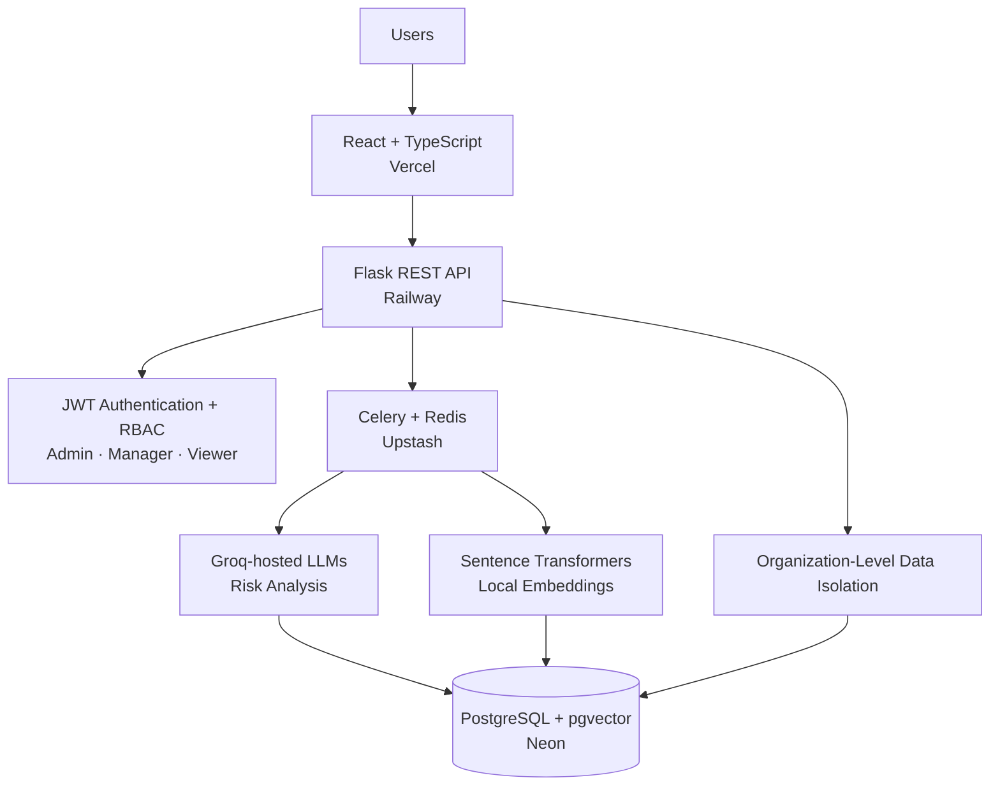
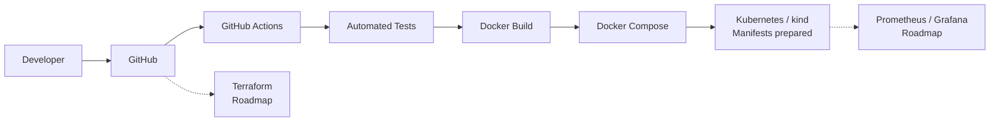
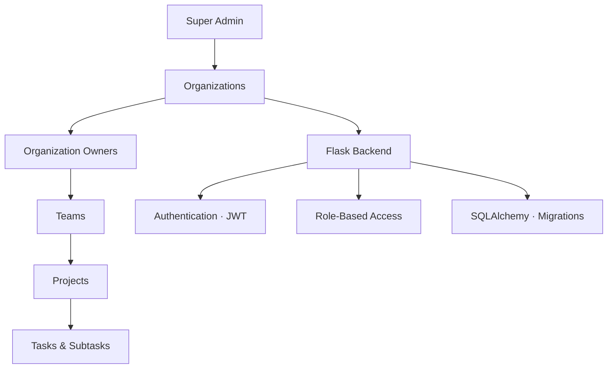

 

  

---

## 01. About Me

Computing graduate (B.Sc., 2025) and aspiring Software Engineer specializing in **backend and full-stack development**. I built **three end-to-end projects** with Python/Flask, React, REST APIs, PostgreSQL, JWT authentication and AI/LLM integration, including a **bilingual telemedicine platform with 56 registered users**.

**What I enjoy engineering:**

- 🔹 Backend systems, REST APIs and scalable application architectures.
- 🔹 Multi-tenant SaaS platforms, authentication and role-based access control.
- 🔹 AI-powered applications: LLM integration, Whisper speech-to-text, semantic search.
- 🔹 React and React Native apps with bilingual (Arabic / English) interfaces.
- 🔹 Docker, Kubernetes, CI/CD pipelines and cloud deployment.

**Currently focused on:** AI engineering · distributed application architecture · Cloud & DevOps.

🎯 Open to **Software Engineer · Backend Developer · Full-Stack Developer · AI Engineer** roles, especially at startups in Egypt and the Gulf region.

---

## 02. Featured Projects

### 🏥 Sahatak (صحتك) — Bilingual Telemedicine Platform
2025 – 2026 · Web & Mobile

A bilingual (Arabic / English) digital healthcare platform that connects patients and doctors through remote consultations, appointment booking, medical records and AI-assisted preliminary symptom assessment.

**System Architecture**

**Engineering highlights**

- Patient and doctor dashboards with authentication and role-based access control (**56 registered users**).
- Real-time patient–doctor chat (file sharing, typing indicators, read receipts) and Jitsi Meet video consultations.
- Appointment booking with email notifications, medical reports, vital-signs tracking and clinic/pharmacy maps; booking confirmation takes about **1–3 seconds on web** and about **1 second on mobile**.
- Bilingual OpenAI symptom-assessment assistant with Whisper voice input (**50+ queries processed**), plus a React Native / TypeScript mobile app on the same APIs (internal testing, pre-release).

**AI Symptom Assessment Workflow**

The assistant gives preliminary guidance only, not a medical diagnosis. Figures are historical project metrics, not live counters.

**Tech:** `Python` `Flask` `SQLAlchemy` `JavaScript` `React Native` `TypeScript` `OpenAI API` `Whisper` `Jitsi Meet`

---

### ⚖️ Lexera — AI Contract Intelligence Platform
2026

A multi-tenant SaaS platform that simplifies legal contract management with AI-powered risk analysis, semantic search and automated renewal alerts.

**Architecture**

**Engineering highlights**

- Multi-tenant Flask backend with **organization-scoped data isolation**, JWT authentication and **three roles** (admin, manager, viewer).
- Automated backend tests for authentication and tenant isolation.
- Celery/Redis background processing for **three workflows**: LLM risk analysis, speech-to-text transcription and renewal alerts.
- Semantic search with PostgreSQL/pgvector, Groq-hosted LLMs and local sentence-transformer embeddings.
- REST APIs and a React/TypeScript front end, deployed across four services: Railway, Neon, Upstash and Vercel.

---

### ☁️ CloudOps Platform — Deploy, Monitor & Manage Cloud Applications
2026 · Active Development

A cloud engineering platform designed to simplify application deployment, automate testing through CI/CD, and manage containerized applications using Docker and Kubernetes.

**Delivery Pipeline**

**Implemented**

- FastAPI backend (**4 API endpoints**, **5 automated tests**) and a React/TypeScript/Vite frontend served via Nginx.
- Containerized with Docker and Docker Compose, plus **1 GitHub Actions CI workflow** for backend and frontend testing.
- Kubernetes manifests prepared (1 planned backend replica, 1 GiB PV/PVC for SQLite on kind).

**Status:** deployment to Kubernetes is not yet completed. Uses SQLite and has no authentication yet. **Roadmap:** Terraform, Prometheus and Grafana.

---

### 📊 PMS — Project Management System
Active Development

A multi-tenant project management SaaS inspired by Jira, Asana and Trello, built to manage organizations, teams, projects and collaborative workflows.

The backend foundation is implemented; some product modules and UI features remain planned or prototyped.

---

## 03. Other Projects

| Project | Description | Technologies |
|---|---|---|
| [Accounts](https://github.com/Awab7-ux/accounts) | Accounts REST service, CI and security headers | Python, Docker |
| [Tax Calculator DevOps](https://github.com/Awab7-ux/tax-calculator-devops-capstone) | Tested tax service and Kubernetes manifests | Flask, Docker, Kubernetes |
| [CI/CD Final Project](https://github.com/Awab7-ux/ci-cd-final-project) | Automated testing and container builds | Node.js, Docker |
| [Full-Stack Capstone](https://github.com/Awab7-ux/xrwvm-fullstack_developer_capstone) | Full-stack application and deployment configuration | Django, Docker |
| [Online Course](https://github.com/Awab7-ux/onlinecourse-final-project) | Online learning platform with assessments | Django |
| [Backend Development Capstone](https://github.com/Awab7-ux/Back-end-Development-Capstone) | Concert website backend | Django |
| [Medical Appointment](https://github.com/Awab7-ux/med_appt) | Doctor appointment booking frontend | JavaScript, HTML, CSS |

---

## 04. Technical Skills

 

 

 

| Area | Skills |
|---|---|
| **Languages** | Python · JavaScript · TypeScript · SQL |
| **Backend** | Flask · FastAPI · REST APIs · SQLAlchemy · Alembic · JWT · RBAC · WebSockets (Flask-SocketIO) · Celery |
| **Frontend & Mobile** | HTML · CSS · React · React Native · TypeScript · Tailwind CSS |
| **Data** | PostgreSQL · pgvector · Redis · Database Migrations · Semantic Search |
| **AI & LLM** | OpenAI API · Groq API · Whisper · Sentence-Transformer Embeddings · LLM Integration |
| **DevOps & Tools** | Docker · Kubernetes · Nginx · Git · GitHub · CI/CD · Railway · Vercel · Neon · Upstash |
| **Testing** | pytest · Automated Backend Testing · API Integration · System Design |

---

## 05. Engineering Principles

| Principle | My Approach |
|---|---|
| 🔐 Security First | Keep secrets server-side and enforce authorization at API boundaries. |
| 🏢 Tenant Isolation | Scope organization data at every query and test isolation boundaries. |
| 🧱 Maintainable Architecture | Separate routers, services, repositories and schemas. |
| 🚀 Reliable Delivery | Automated tests, CI workflows and containerized environments. |
| 🤖 Practical AI | Integrate AI into real workflows with clear limitations and safeguards. |
| 📝 Transparency | Clearly distinguish implemented features from prototypes and roadmap items. |

---

## 06. Certifications

 

 

<b>📜 Full certification list</b>

 

**Artificial Intelligence & Generative AI**
- IBM Generative AI Engineering Professional Certificate
- IBM Generative AI Essentials for Software Developers V2
- IBM AI Engineering Professional Certificate (V3)
- AI Capstone Project with Deep Learning (IBM)
- Z DevOps Testing Fundamentals (IBM)
- Python for Data Science, AI & Development (IBM)
- AI Fluency: Framework & Foundations (Anthropic)
- Generative AI Leader Professional Certificate (Google Cloud)

**DevOps, CI/CD & Infrastructure**
- IBM DevOps and Software Engineering Professional Certificate (IBM / Coursera, 2026)
- Continuous Integration & Continuous Delivery, CI/CD (IBM)
- Docker Practical Course (Devopsarea)
- Kubernetes CKA Badge (Credly) · Kubernetes CKA: Services and Networking

**Cloud Computing**
- Essential Google Cloud Infrastructure: Foundation & Core Services (Google Cloud)
- Preparing for Google Cloud Certification: Cloud Engineer (Google Cloud)
- Intel Partner Technical Pro: Cloud DevOps Competency (Intel)

**Software Engineering & Full-Stack Development**
- IBM Full Stack Software Developer Professional Certificate
- IBM Front-End Developer Professional Certificate
- IBM Back-End Development Professional Certificate
- Full-Stack Web Developers and Back-End Developers (IBM)
- Apply Software Engineering Principles to Drive Reliability (IBM)
- Full Stack Software Developer Assessment (IBM)
- System Design and Architecture (Manara)

**Databases, APIs & Security**
- Databases (Manara)
- OpenAPI Fundamentals, LFEL1011 (Linux Foundation)
- for Software Development Managers, LFD125 (Linux Foundation)

**Programming**
- Python Essentials 1 and 2 (Cisco)

Verify credentials through the linked Credly pages. These are professional certificates and course-completion credentials, not proctored vendor certification exams.

---

## 07. Education

🎓 **Bachelor of Science (B.Sc.) in Computing** — Future University, Khartoum, Sudan · 2021 – 2025
🌐 Languages: Arabic, English

---

## 08. GitHub Analytics

  

  

  

  

<picture>
  <source media="(prefers-color-scheme: dark)" srcset="https://raw.githubusercontent.com/Awab7-ux/Awab7-ux/output/github-snake-dark.svg"/>
  <source media="(prefers-color-scheme: light)" srcset="https://raw.githubusercontent.com/Awab7-ux/Awab7-ux/output/github-snake.svg"/>
  
</picture>

---

## 09. Let's Connect

**I build software that solves problems, connects systems and creates meaningful impact.**

Open to engineering opportunities, technical discussions and collaborations.

 

  

Designed and engineered by Awab Imad · Always building. Always learning.

