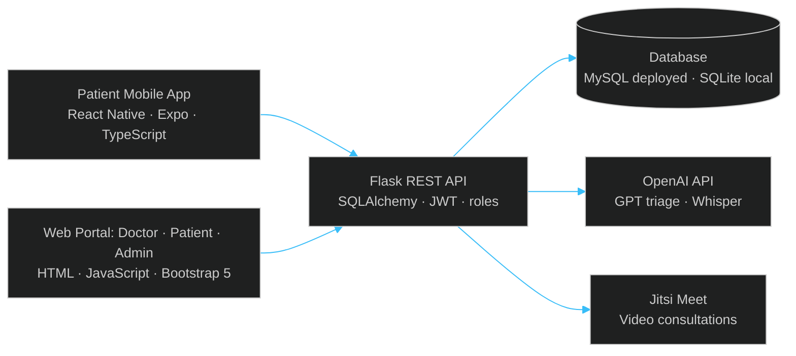
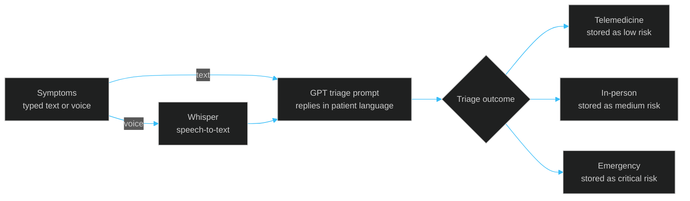
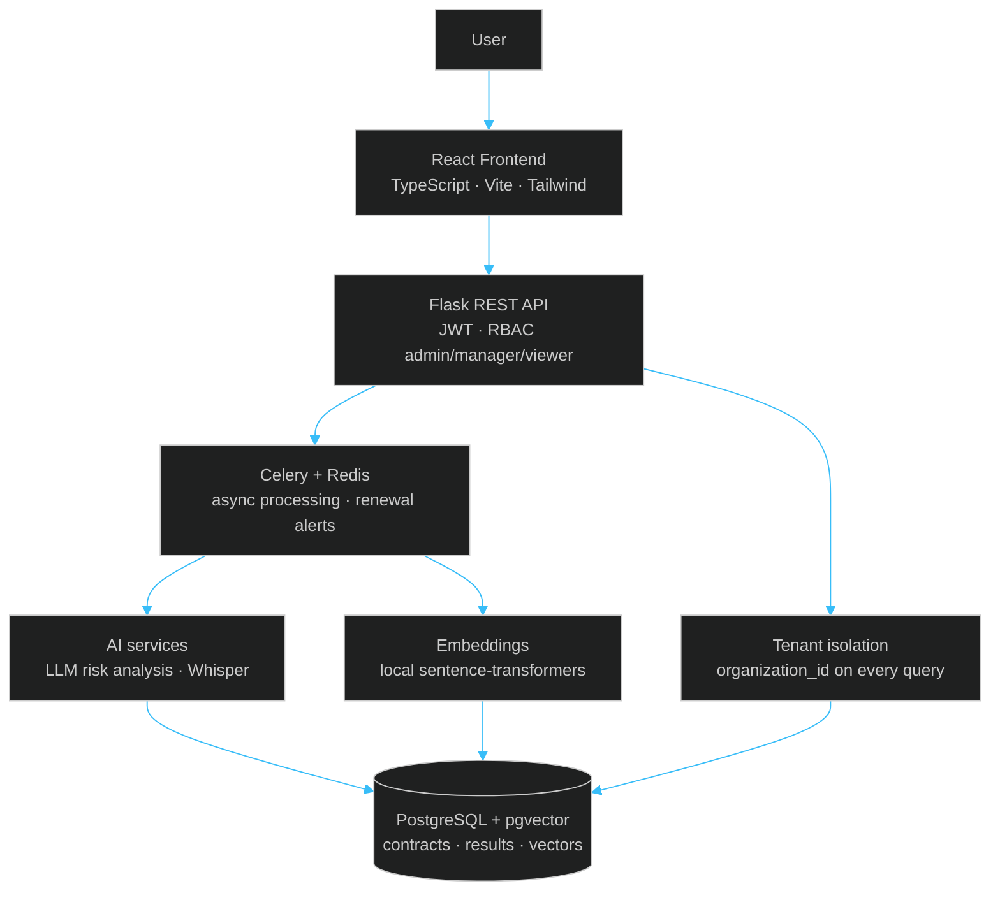
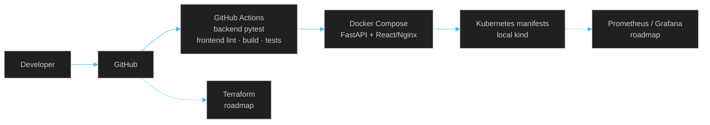
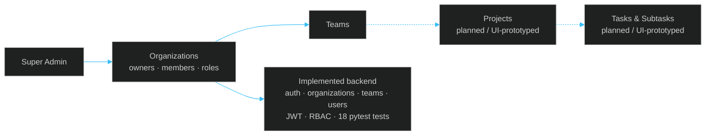

```mermaid
%%{init: {'theme':'dark','themeVariables':{'primaryColor':'#0F2A4A','primaryBorderColor':'#38BDF8','lineColor':'#38BDF8','primaryTextColor':'#E6F1FF','fontSize':'14px'}}}%%
flowchart LR
  A["1 Open app<br/>AR / EN"] --> B["2 Authenticate<br/>JWT login"] --> C["3 Find a doctor<br/>search · profiles"] --> D["4 Book appointment<br/>status · history"]
  D --> E["5 AI assessment<br/>preliminary triage"] --> F["6 Consultation<br/>video · messaging"] --> G["7 Records<br/>reports · prescriptions"] --> H["8 Follow-up<br/>notifications"]
```
 

**Current focus:** AI-integrated products &nbsp;·&nbsp; multi-tenant backends &nbsp;·&nbsp; Cloud &amp; DevOps

 

[About](#about) · [Sahatak](#featured-sahatak) · [Lexera](#lexera) · [CloudOps](#cloudops-platform) · [PMS](#project-management-system-pms) · [Other work](#other-engineering-projects) · [Skills](#technical-skills) · [Certifications](#certifications) · [Analytics](#github-analytics) · [Contact](#contact)

 

## About

I design, build and integrate complete software systems: secure REST backends, clean React and React Native clients, and AI features that sit inside real product workflows. I enjoy turning complex ideas into practical, usable software.

| Engineering focus | What it looks like in my projects |
| :-- | :-- |
| **Backend and APIs** | Flask and FastAPI services, layered architecture, JWT authentication, role-based access |
| **Full-stack delivery** | React and TypeScript web apps, a React Native / Expo mobile app, Arabic and English interfaces |
| **AI integration** | LLM triage and risk analysis, speech-to-text, semantic search with pgvector |
| **Systems and data** | PostgreSQL, MySQL, SQLite, Redis, Celery background processing, multi-tenant data isolation |
| **Cloud and DevOps** | Docker, Docker Compose, GitHub Actions, Kubernetes manifests (local kind), Nginx |

Computing graduate (B.Sc.), open to **Software Engineer, Backend, Full-Stack and AI Engineer** roles, and to collaboration on open-source and innovative technology projects.

 

## Featured: Sahatak

### Sahatak (صحتك) · Integrated Telemedicine Platform

*Bilingual (Arabic / English) digital healthcare: patients, doctors and administrators on one shared backend.*

Access to healthcare can be limited by distance, transportation, scarce medical resources and unreliable connectivity. Sahatak aims to reduce those barriers with remote consultations, appointment booking, medical records and AI-assisted preliminary symptom assessment. The engineering challenge was making several clients, a REST backend and external services behave as one coherent system.

### The three components

| Component | Stack | Repository |
| :-- | :-- | :-- |
| **Patient mobile app** | React Native · Expo · TypeScript | [`Sahatak-Telemedicine-App2/sahatak-mobile`](https://github.com/Awab7-ux/Sahatak-Telemedicine-App2/tree/main/sahatak-mobile) |
| **Web portal** for doctors, patients and admins | HTML · JavaScript · Bootstrap 5 (RTL support) | [`sahataksudan-collab/Sahatak`](https://github.com/sahataksudan-collab/Sahatak) (team repository) |
| **Shared REST backend** | Python · Flask · SQLAlchemy · JWT | [`sahataksudan-collab/Sahatak`](https://github.com/sahataksudan-collab/Sahatak) (team repository) |

The Awab7-ux repository also contains a companion Flask + PostgreSQL backend with Docker Compose (auth, doctors, appointments, records, pharmacy, clinics, notifications, chat) and a web prototype. The deployed web stack uses MySQL; local development falls back to SQLite.

### Patient mobile app modules

<table>
  <tr>
    <td width="33%" valign="top"><b>Authentication and profile</b> Registration, login, profile and user settings</td>
    <td width="33%" valign="top"><b>Doctor discovery</b> Browse doctors and view profiles</td>
    <td width="33%" valign="top"><b>Appointments</b> Booking flow, details and history</td>
  </tr>
  <tr>
    <td valign="top"><b>Medical records</b> Records and care-summary screens</td>
    <td valign="top"><b>Video consultation</b> Jitsi Meet sessions configured by the backend</td>
    <td valign="top"><b>Messaging</b> Patient-doctor chat over HTTP polling</td>
  </tr>
  <tr>
    <td valign="top"><b>Pharmacy</b> Products and cart workflows</td>
    <td valign="top"><b>Clinic locator</b> Map-based clinic exploration</td>
    <td valign="top"><b>Checkups and notifications</b> Medical checkup screen, notification center, Calm Mode setting</td>
  </tr>
</table>

### Doctor and admin web portal

Doctor authentication and verification, dashboards, availability management, electronic health records, prescriptions, patient messaging, video consultations, notifications, calendar sync, and admin and support tooling, all served by the shared backend.

### AI-assisted symptom assessment

Voice input is transcribed with OpenAI Whisper; a GPT triage prompt (language-matched to the patient) recommends a care path. The result is a **preliminary assessment and does not replace professional medical diagnosis.**

### Patient journey

### Engineering highlights

| | |
| :-- | :-- |
| **56** registered users | **50+** AI symptom-assessment queries processed |
| **3** coordinated components | **AR / EN** bilingual experience |

User and query figures are historical project metrics, not live counters. The mobile APK has not been publicly released.

Technical notes: JWT authentication · Jitsi Meet integration · OpenAI GPT and Whisper · messaging deliberately built on **HTTP polling rather than WebSockets** for proxy compatibility.

 

## Lexera

### AI Contract Intelligence SaaS Platform

A multi-tenant platform that automates legal-contract review: risk analysis, semantic search and renewal alerts for organizations with large contract portfolios.

<table>
  <tr>
    <td width="50%" valign="top"><b>Multi-tenant security</b> Organization-scoped data on every query, JWT auth, admin / manager / viewer roles, automated tenant-isolation tests</td>
    <td width="50%" valign="top"><b>AI contract analysis</b> LLM risk analysis flags problematic clauses and missing terms; version-comparison summaries; voice notes with speech-to-text</td>
  </tr>
  <tr>
    <td valign="top"><b>Semantic search</b> PostgreSQL pgvector with local sentence-transformer embeddings to reduce API cost</td>
    <td valign="top"><b>Background processing</b> Celery and Redis for analysis, transcription and scheduled renewal alerts</td>
  </tr>
</table>

Deployed across Railway, Neon, Upstash and Vercel. &nbsp;

 

## CloudOps Platform

### Cloud Infrastructure and Deployment Management (in active development)

A FastAPI backend with a React dashboard for managing applications, deployments, logs and alerts, built to practice production-style DevOps: testing, containers, CI and Kubernetes.

<table>
  <tr>
    <td width="33%" valign="top"><b>API infrastructure</b> Layered routers, services, repositories and schemas; request-ID logging; pagination; around 240 pytest test functions</td>
    <td width="33%" valign="top"><b>Containerization</b> Docker images (non-root backend), Compose, React served through Nginx</td>
    <td width="33%" valign="top"><b>CI and Kubernetes</b> GitHub Actions for backend and frontend; Deployment, Service, ConfigMap and PVC manifests for local kind</td>
  </tr>
</table>

**Roadmap (not yet implemented):** Terraform and Prometheus / Grafana monitoring. **Known limits:** SQLite, no authentication yet, some dashboard pages use labeled demo data. &nbsp;

 

## Project Management System (PMS)

### Multi-Tenant Project Management SaaS (active development)

A project-management platform for organizations and teams, inspired by tools such as Jira, Asana and Trello. The backend foundation (authentication, organizations, teams, users, role-based access) is implemented with a Flask application factory, SQLAlchemy and migrations; the system design, ERD and use-case diagrams are documented in the repository.

<table>
  <tr>
    <td width="33%"></td>
    <td width="33%"></td>
    <td width="33%"></td>
  </tr>
</table>

Planned stack per the design docs; the project is in progress and not complete. &nbsp;

 

## Other Engineering Projects

| Project | Purpose | Stack | Status |
| :-- | :-- | :-- | :-- |
| [accounts](https://github.com/Awab7-ux/accounts) | Accounts REST service with CI workflow and security headers | Python · Docker · GitHub Actions | Coursework |
| [tax-calculator-devops-capstone](https://github.com/Awab7-ux/tax-calculator-devops-capstone) | Tax calculation service with tests and Kubernetes manifests | Python · Flask · Docker · Kubernetes · pytest | Coursework |
| [ci-cd-final-project](https://github.com/Awab7-ux/ci-cd-final-project) | Small service with automated tests and container build | Node.js · Docker | Coursework |
| [xrwvm-fullstack_developer_capstone](https://github.com/Awab7-ux/xrwvm-fullstack_developer_capstone) | Full-stack capstone with CI and deployment configuration | Django · Docker | Coursework |
| [onlinecourse-final-project](https://github.com/Awab7-ux/onlinecourse-final-project) | Online course app with an assessment feature | Django | Coursework |
| [Back-end-Development-Capstone](https://github.com/Awab7-ux/Back-end-Development-Capstone) | Concert-site backend capstone | Django | Coursework |
| [med_appt](https://github.com/Awab7-ux/med_appt) | Online doctor-appointment booking front end | JavaScript · HTML · CSS | Coursework |

 

## Technical Skills

<table>
  <tr><td width="28%"><b>Languages</b></td><td></td></tr>
  <tr><td><b>Backend</b></td><td> &nbsp;SQLAlchemy · REST APIs · JWT · Celery</td></tr>
  <tr><td><b>Frontend and mobile</b></td><td> &nbsp;React Native · Expo</td></tr>
  <tr><td><b>Databases</b></td><td> &nbsp;pgvector</td></tr>
  <tr><td><b>AI engineering</b></td><td>OpenAI API · Whisper · Groq-hosted LLMs · sentence-transformers · embeddings · semantic search</td></tr>
  <tr><td><b>Cloud and DevOps</b></td><td></td></tr>
  <tr><td><b>Testing and tools</b></td><td> &nbsp;pytest · API and tenant-isolation testing</td></tr>
  <tr><td><b>Learning next</b></td><td>Terraform · Prometheus / Grafana · scalable system design</td></tr>
</table>

### Engineering principles

- **Isolate tenants by design:** scope every query by organization and test the boundary.
- **Layer the backend:** routers, services, repositories and schemas keep logic testable.
- **Keep secrets server-side:** environment-based configuration, containers running as non-root.
- **Be honest about status:** shipped, in progress and roadmap are labeled separately.

 

## Certifications

[-06B6D4?style=for-the-badge&logo=coursera&logoColor=white&labelColor=0A192F)](https://www.credly.com/badges/50ee3989-fa66-4d57-a522-22a7f1e35f52)

Professional certificates and course-completion badges delivered via Coursera and verifiable on Credly. None is a proctored vendor exam.

 

## GitHub Analytics

 

<picture>
  <source media="(prefers-color-scheme: dark)" srcset="https://raw.githubusercontent.com/Awab7-ux/Awab7-ux/output/github-snake-dark.svg"/>
  <source media="(prefers-color-scheme: light)" srcset="https://raw.githubusercontent.com/Awab7-ux/Awab7-ux/output/github-snake.svg"/>
  
</picture>

 

## Contact

*I build software that is reliable, well-tested and honest about what it does. Let's talk about engineering roles or collaboration.*

name: Generate Snake Animation

on:
  schedule:
    - cron: "0 0 * * *"
  workflow_dispatch:
  push:
    branches: [main]

permissions:
  contents: write

jobs:
  generate:
    runs-on: ubuntu-latest
    steps:
      - uses: Platane/snk/svg-only@v3
        with:
          github_user_name: ${{ github.repository_owner }}
          outputs: |
            dist/github-snake.svg
            dist/github-snake-dark.svg?palette=github-dark
      - uses: crazy-max/ghaction-github-pages@v3.1.0
        with:
          target_branch: output
          build_dir: dist
        env:
          GITHUB_TOKEN: ${{ secrets.GITHUB_TOKEN }}

          

 

**Current focus:** AI-integrated products &nbsp;·&nbsp; multi-tenant backends &nbsp;·&nbsp; Cloud &amp; DevOps

 

[About](#about) · [Sahatak](#featured-sahatak) · [Lexera](#lexera) · [CloudOps](#cloudops-platform) · [PMS](#project-management-system-pms) · [Other work](#other-engineering-projects) · [Skills](#technical-skills) · [Certifications](#certifications) · [Analytics](#github-analytics) · [Contact](#contact)

 

## About

I design, build and integrate complete software systems: secure REST backends, clean React and React Native clients, and AI features that sit inside real product workflows. I enjoy turning complex ideas into practical, usable software.

| Engineering focus | What it looks like in my projects |
| :-- | :-- |
| **Backend and APIs** | Flask and FastAPI services, layered architecture, JWT authentication, role-based access |
| **Full-stack delivery** | React and TypeScript web apps, a React Native / Expo mobile app, Arabic and English interfaces |
| **AI integration** | LLM triage and risk analysis, speech-to-text, semantic search with pgvector |
| **Systems and data** | PostgreSQL, MySQL, SQLite, Redis, Celery background processing, multi-tenant data isolation |
| **Cloud and DevOps** | Docker, Docker Compose, GitHub Actions, Kubernetes manifests (local kind), Nginx |

Computing graduate (B.Sc.), open to **Software Engineer, Backend, Full-Stack and AI Engineer** roles, and to collaboration on open-source and innovative technology projects.

 

## Featured: Sahatak

### Sahatak (صحتك) · Integrated Telemedicine Platform

*Bilingual (Arabic / English) digital healthcare: patients, doctors and administrators on one shared backend.*

Access to healthcare can be limited by distance, transportation, scarce medical resources and unreliable connectivity. Sahatak aims to reduce those barriers with remote consultations, appointment booking, medical records and AI-assisted preliminary symptom assessment. The engineering challenge was making several clients, a REST backend and external services behave as one coherent system.

### The three components

| Component | Stack | Repository |
| :-- | :-- | :-- |
| **Patient mobile app** | React Native · Expo · TypeScript | [`Sahatak-Telemedicine-App2/sahatak-mobile`](https://github.com/Awab7-ux/Sahatak-Telemedicine-App2/tree/main/sahatak-mobile) |
| **Web portal** for doctors, patients and admins | HTML · JavaScript · Bootstrap 5 (RTL support) | [`sahataksudan-collab/Sahatak`](https://github.com/sahataksudan-collab/Sahatak) (team repository) |
| **Shared REST backend** | Python · Flask · SQLAlchemy · JWT | [`sahataksudan-collab/Sahatak`](https://github.com/sahataksudan-collab/Sahatak) (team repository) |

The Awab7-ux repository also contains a companion Flask + PostgreSQL backend with Docker Compose (auth, doctors, appointments, records, pharmacy, clinics, notifications, chat) and a web prototype. The deployed web stack uses MySQL; local development falls back to SQLite.

### Patient mobile app modules

<table>
  <tr>
    <td width="33%" valign="top"><b>Authentication and profile</b> Registration, login, profile and user settings</td>
    <td width="33%" valign="top"><b>Doctor discovery</b> Browse doctors and view profiles</td>
    <td width="33%" valign="top"><b>Appointments</b> Booking flow, details and history</td>
  </tr>
  <tr>
    <td valign="top"><b>Medical records</b> Records and care-summary screens</td>
    <td valign="top"><b>Video consultation</b> Jitsi Meet sessions configured by the backend</td>
    <td valign="top"><b>Messaging</b> Patient-doctor chat over HTTP polling</td>
  </tr>
  <tr>
    <td valign="top"><b>Pharmacy</b> Products and cart workflows</td>
    <td valign="top"><b>Clinic locator</b> Map-based clinic exploration</td>
    <td valign="top"><b>Checkups and notifications</b> Medical checkup screen, notification center, Calm Mode setting</td>
  </tr>
</table>

### Doctor and admin web portal

Doctor authentication and verification, dashboards, availability management, electronic health records, prescriptions, patient messaging, video consultations, notifications, calendar sync, and admin and support tooling, all served by the shared backend.

### AI-assisted symptom assessment

Voice input is transcribed with OpenAI Whisper; a GPT triage prompt (language-matched to the patient) recommends a care path. The result is a **preliminary assessment and does not replace professional medical diagnosis.**

### Patient journey

### Engineering highlights

| | |
| :-- | :-- |
| **56** registered users | **50+** AI symptom-assessment queries processed |
| **3** coordinated components | **AR / EN** bilingual experience |

User and query figures are historical project metrics, not live counters. The mobile APK has not been publicly released.

Technical notes: JWT authentication · Jitsi Meet integration · OpenAI GPT and Whisper · messaging deliberately built on **HTTP polling rather than WebSockets** for proxy compatibility.

 

## Lexera

### AI Contract Intelligence SaaS Platform

A multi-tenant platform that automates legal-contract review: risk analysis, semantic search and renewal alerts for organizations with large contract portfolios.

<table>
  <tr>
    <td width="50%" valign="top"><b>Multi-tenant security</b> Organization-scoped data on every query, JWT auth, admin / manager / viewer roles, automated tenant-isolation tests</td>
    <td width="50%" valign="top"><b>AI contract analysis</b> LLM risk analysis flags problematic clauses and missing terms; version-comparison summaries; voice notes with speech-to-text</td>
  </tr>
  <tr>
    <td valign="top"><b>Semantic search</b> PostgreSQL pgvector with local sentence-transformer embeddings to reduce API cost</td>
    <td valign="top"><b>Background processing</b> Celery and Redis for analysis, transcription and scheduled renewal alerts</td>
  </tr>
</table>

Deployed across Railway, Neon, Upstash and Vercel. &nbsp;

 

## CloudOps Platform

### Cloud Infrastructure and Deployment Management (in active development)

A FastAPI backend with a React dashboard for managing applications, deployments, logs and alerts, built to practice production-style DevOps: testing, containers, CI and Kubernetes.

<table>
  <tr>
    <td width="33%" valign="top"><b>API infrastructure</b> Layered routers, services, repositories and schemas; request-ID logging; pagination; around 240 pytest test functions</td>
    <td width="33%" valign="top"><b>Containerization</b> Docker images (non-root backend), Compose, React served through Nginx</td>
    <td width="33%" valign="top"><b>CI and Kubernetes</b> GitHub Actions for backend and frontend; Deployment, Service, ConfigMap and PVC manifests for local kind</td>
  </tr>
</table>

**Roadmap (not yet implemented):** Terraform and Prometheus / Grafana monitoring. **Known limits:** SQLite, no authentication yet, some dashboard pages use labeled demo data. &nbsp;

 

## Project Management System (PMS)

### Multi-Tenant Project Management SaaS (active development)

A project-management platform for organizations and teams, inspired by tools such as Jira, Asana and Trello. The backend foundation (authentication, organizations, teams, users, role-based access) is implemented with a Flask application factory, SQLAlchemy and migrations; the system design, ERD and use-case diagrams are documented in the repository.

<table>
  <tr>
    <td width="33%"></td>
    <td width="33%"></td>
    <td width="33%"></td>
  </tr>
</table>

Planned stack per the design docs; the project is in progress and not complete. &nbsp;

 

## Other Engineering Projects

| Project | Purpose | Stack | Status |
| :-- | :-- | :-- | :-- |
| [accounts](https://github.com/Awab7-ux/accounts) | Accounts REST service with CI workflow and security headers | Python · Docker · GitHub Actions | Coursework |
| [tax-calculator-devops-capstone](https://github.com/Awab7-ux/tax-calculator-devops-capstone) | Tax calculation service with tests and Kubernetes manifests | Python · Flask · Docker · Kubernetes · pytest | Coursework |
| [ci-cd-final-project](https://github.com/Awab7-ux/ci-cd-final-project) | Small service with automated tests and container build | Node.js · Docker | Coursework |
| [xrwvm-fullstack_developer_capstone](https://github.com/Awab7-ux/xrwvm-fullstack_developer_capstone) | Full-stack capstone with CI and deployment configuration | Django · Docker | Coursework |
| [onlinecourse-final-project](https://github.com/Awab7-ux/onlinecourse-final-project) | Online course app with an assessment feature | Django | Coursework |
| [Back-end-Development-Capstone](https://github.com/Awab7-ux/Back-end-Development-Capstone) | Concert-site backend capstone | Django | Coursework |
| [med_appt](https://github.com/Awab7-ux/med_appt) | Online doctor-appointment booking front end | JavaScript · HTML · CSS | Coursework |

 

## Technical Skills

<table>
  <tr><td width="28%"><b>Languages</b></td><td></td></tr>
  <tr><td><b>Backend</b></td><td> &nbsp;SQLAlchemy · REST APIs · JWT · Celery</td></tr>
  <tr><td><b>Frontend and mobile</b></td><td> &nbsp;React Native · Expo</td></tr>
  <tr><td><b>Databases</b></td><td> &nbsp;pgvector</td></tr>
  <tr><td><b>AI engineering</b></td><td>OpenAI API · Whisper · Groq-hosted LLMs · sentence-transformers · embeddings · semantic search</td></tr>
  <tr><td><b>Cloud and DevOps</b></td><td></td></tr>
  <tr><td><b>Testing and tools</b></td><td> &nbsp;pytest · API and tenant-isolation testing</td></tr>
  <tr><td><b>Learning next</b></td><td>Terraform · Prometheus / Grafana · scalable system design</td></tr>
</table>

### Engineering principles

- **Isolate tenants by design:** scope every query by organization and test the boundary.
- **Layer the backend:** routers, services, repositories and schemas keep logic testable.
- **Keep secrets server-side:** environment-based configuration, containers running as non-root.
- **Be honest about status:** shipped, in progress and roadmap are labeled separately.

 

## Certifications

[-06B6D4?style=for-the-badge&logo=coursera&logoColor=white&labelColor=0A192F)](https://www.credly.com/badges/50ee3989-fa66-4d57-a522-22a7f1e35f52)

Professional certificates and course-completion badges delivered via Coursera and verifiable on Credly. None is a proctored vendor exam.

 

## GitHub Analytics

 

<picture>
  <source media="(prefers-color-scheme: dark)" srcset="https://raw.githubusercontent.com/Awab7-ux/Awab7-ux/output/github-snake-dark.svg"/>
  <source media="(prefers-color-scheme: light)" srcset="https://raw.githubusercontent.com/Awab7-ux/Awab7-ux/output/github-snake.svg"/>
  
</picture>

 

## Contact

*I build software that is reliable, well-tested and honest about what it does. Let's talk about engineering roles or collaboration.*

