


 

  

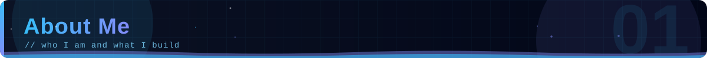

Computing graduate (B.Sc., 2025) and aspiring Software Engineer specializing in **backend and full-stack development**. I built **three end-to-end projects** with Python/Flask, React, REST APIs, PostgreSQL, JWT authentication and AI/LLM integration, including a **bilingual telemedicine platform with 56 registered users**.

| 🧠 Backend & APIs | 🤖 AI Integration | 🎨 Full-Stack | ☁️ Cloud & DevOps |
|:---:|:---:|:---:|:---:|
| REST APIs, Multi-tenant SaaS, JWT, RBAC | LLMs, Whisper, Embeddings, Semantic Search | React, React Native, Bilingual RTL UIs | Docker, Kubernetes, CI/CD |

**Currently focused on:** AI engineering · distributed application architecture · Cloud & DevOps.

🎯 Open to **Software Engineer · Backend Developer · Full-Stack Developer · AI Engineer** roles, especially at startups in Egypt and the Gulf region.

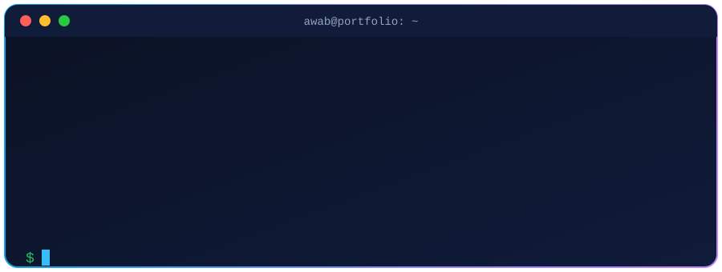

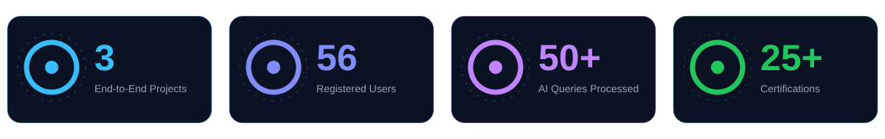

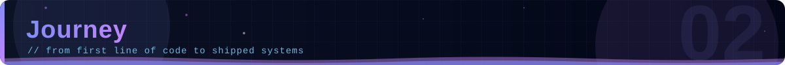

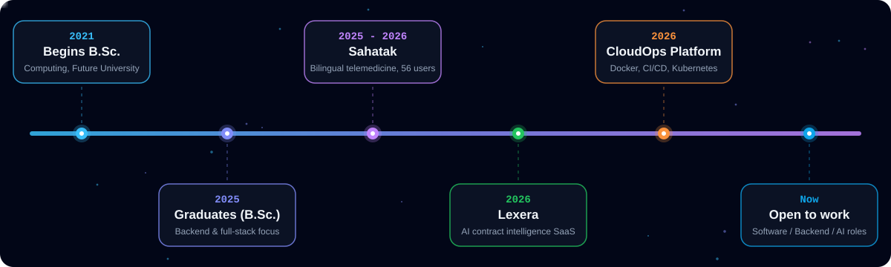

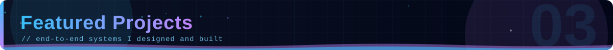


  

A bilingual (Arabic / English) healthcare platform connecting patients and doctors through remote consultations, appointment booking, medical records and AI-assisted preliminary symptom assessment.

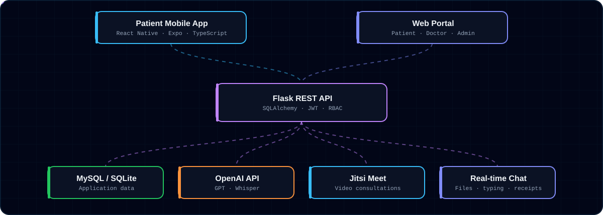

**Highlights**

- 👥 Patient and doctor dashboards with authentication and role-based access control (**56 registered users**).
- 💬 Real-time chat (file sharing, typing indicators, read receipts) and Jitsi Meet video consultations.
- 📅 Appointment booking with email notifications, medical reports, vital-signs tracking and clinic/pharmacy maps; confirmation in about **1–3 s on web** and about **1 s on mobile**.
- 🎙️ Bilingual OpenAI symptom-assessment assistant with Whisper voice input (**50+ queries processed**) and a React Native / TypeScript app on the same APIs (internal testing, pre-release).

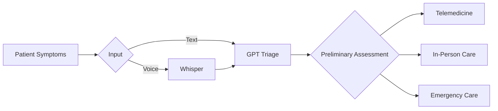

Preliminary guidance only, not a medical diagnosis. Figures are historical project metrics, not live counters.


  

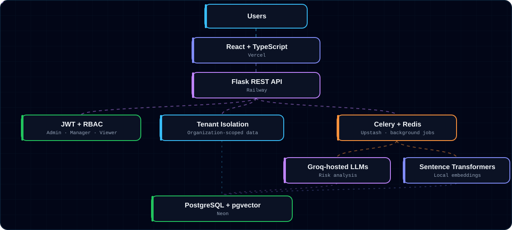

**Highlights**

- 🏢 Multi-tenant Flask backend with **organization-scoped data isolation**, JWT authentication and **three roles** (admin, manager, viewer), covered by automated tests for auth and tenant isolation.
- ⚙️ Celery/Redis background processing for **three workflows**: LLM risk analysis, speech-to-text transcription and renewal alerts.
- 🔎 Semantic search with PostgreSQL/pgvector, Groq-hosted LLMs and local sentence-transformer embeddings.
- 🚀 REST APIs and a React/TypeScript front end deployed across four services: Railway, Neon, Upstash and Vercel.

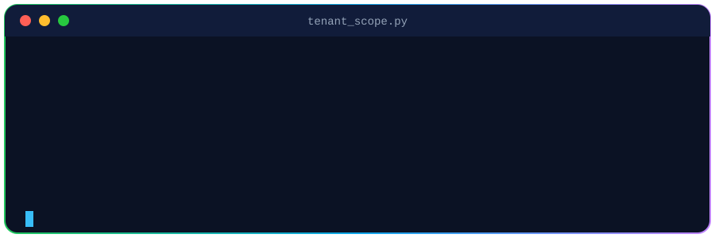


  

A cloud engineering platform that simplifies application deployment, automates testing through CI/CD, and manages containerized applications with Docker and Kubernetes.

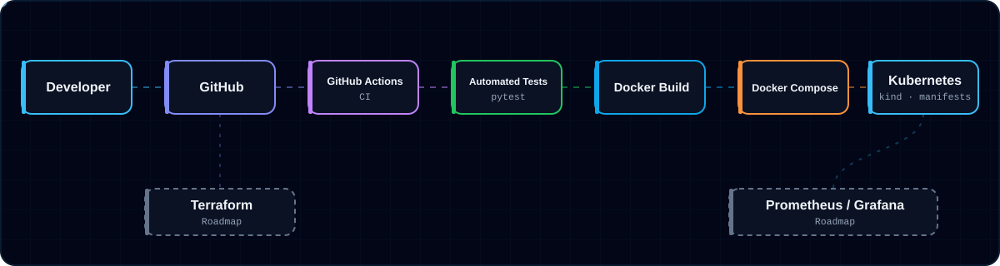

- ✅ FastAPI backend (**4 API endpoints**, **5 automated tests**) and React/TypeScript/Vite frontend served via Nginx.
- ✅ Docker and Docker Compose, plus **1 GitHub Actions CI workflow** for backend and frontend testing.
- 🛠️ Kubernetes manifests prepared (1 planned backend replica, 1 GiB PV/PVC for SQLite on kind).

Status: Kubernetes deployment not yet completed; uses SQLite and has no authentication yet. Roadmap: Terraform, Prometheus and Grafana.


A multi-tenant project management SaaS inspired by Jira, Asana and Trello, built to manage organizations, teams, projects and collaborative workflows.

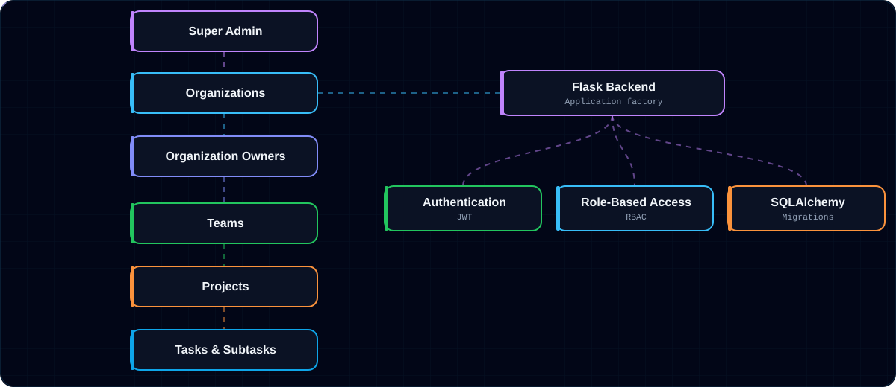

The backend foundation is implemented; some product modules and UI features remain planned or prototyped.

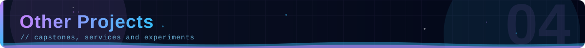

| Project | Description | Technologies |
|---|---|---|
| [Accounts](https://github.com/Awab7-ux/accounts) | Accounts REST service, CI and security headers | Python, Docker |
| [Tax Calculator DevOps](https://github.com/Awab7-ux/tax-calculator-devops-capstone) | Tested tax service and Kubernetes manifests | Flask, Docker, Kubernetes |
| [CI/CD Final Project](https://github.com/Awab7-ux/ci-cd-final-project) | Automated testing and container builds | Node.js, Docker |
| [Full-Stack Capstone](https://github.com/Awab7-ux/xrwvm-fullstack_developer_capstone) | Full-stack application and deployment configuration | Django, Docker |
| [Online Course](https://github.com/Awab7-ux/onlinecourse-final-project) | Online learning platform with assessments | Django |
| [Backend Development Capstone](https://github.com/Awab7-ux/Back-end-Development-Capstone) | Concert website backend | Django |
| [Medical Appointment](https://github.com/Awab7-ux/med_appt) | Doctor appointment booking frontend | JavaScript, HTML, CSS |

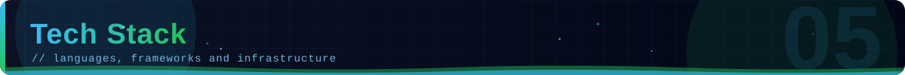



 

 

 

| Area | Skills |
|---|---|
| **Languages** | Python · JavaScript · TypeScript · SQL |
| **Backend** | Flask · FastAPI · REST APIs · SQLAlchemy · Alembic · JWT · RBAC · WebSockets (Flask-SocketIO) · Celery |
| **Frontend & Mobile** | HTML · CSS · React · React Native · TypeScript · Tailwind CSS |
| **Data** | PostgreSQL · pgvector · Redis · Database Migrations · Semantic Search |
| **AI & LLM** | OpenAI API · Groq API · Whisper · Sentence-Transformer Embeddings · LLM Integration |
| **DevOps & Tools** | Docker · Kubernetes · Nginx · Git · GitHub · CI/CD · Railway · Vercel · Neon · Upstash |
| **Testing** | pytest · Automated Backend Testing · API Integration · System Design |

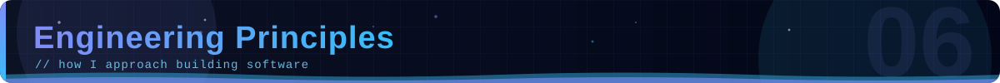

| Principle | My Approach |
|---|---|
| 🔐 Security First | Keep secrets server-side and enforce authorization at API boundaries. |
| 🏢 Tenant Isolation | Scope organization data at every query and test isolation boundaries. |
| 🧱 Maintainable Architecture | Separate routers, services, repositories and schemas. |
| 🚀 Reliable Delivery | Automated tests, CI workflows and containerized environments. |
| 🤖 Practical AI | Integrate AI into real workflows with clear limitations and safeguards. |
| 📝 Transparency | Clearly distinguish implemented features from prototypes and roadmap items. |

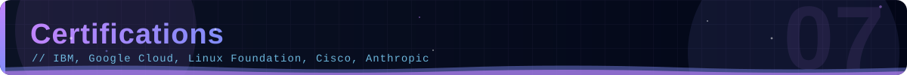

 
<b>IBM · Professional Certificates (issued via Coursera)</b>

<table>
<tr>
<td align="center" width="25%"> <b>Generative AI Engineering</b></td>
<td align="center" width="25%"> <b>AI Engineering (V3)</b></td>
<td align="center" width="25%"> <b>Full Stack Software Developer (V5)</b></td>
<td align="center" width="25%"> <b>DevOps & Software Engineering</b></td>
</tr>
<tr>
<td align="center"> <b>Back-End Development</b></td>
<td align="center"> <b>Front-End Developer</b></td>
<td align="center"> <b>Continuous Integration & Delivery (CI/CD)</b></td>
<td></td>
</tr>
</table>

 

 
<b>Google Cloud · via Coursera</b>

<table>
<tr>
<td align="center" width="50%"> <b>Generative AI Leader</b> Professional Certificate</td>
<td align="center" width="50%"> <b>Preparing for Google Cloud Certification: Cloud Engineer</b></td>
</tr>
</table>

 

 
<b>The Linux Foundation</b>

<table>
<tr>
<td align="center" width="50%"> <b>LFD116 · Software Engineering Basics for Embedded Systems</b></td>
<td align="center" width="50%"> <b>LFD125 · Security for Software Development Managers</b></td>
</tr>
</table>

 

 
<b>Cisco · OpenEDG Python Institute</b>

<table>
<tr>
<td align="center" width="50%"> <b>Python Essentials 1</b></td>
<td align="center" width="50%"> <b>Python Essentials 2</b></td>
</tr>
</table>

 

 
<b>Intel · Anthropic</b>

<table>
<tr>
<td align="center" width="50%"> <b>Intel · Cloud DevOps</b></td>
<td align="center" width="50%"> <b>Anthropic · AI Fluency for Nonprofits</b></td>
</tr>
</table>

<b>📜 Full certification list</b>

 

**Artificial Intelligence & Generative AI**
- IBM Generative AI Engineering Professional Certificate
- IBM Generative AI Essentials for Software Developers V2
- IBM AI Engineering Professional Certificate (V3)
- AI Capstone Project with Deep Learning (IBM)
- Z DevOps Testing Fundamentals (IBM)
- Python for Data Science, AI & Development (IBM)
- AI Fluency: Framework & Foundations (Anthropic)
- Generative AI Leader Professional Certificate (Google Cloud)

**DevOps, CI/CD & Infrastructure**
- IBM DevOps and Software Engineering Professional Certificate (IBM / Coursera, 2026)
- Continuous Integration & Continuous Delivery, CI/CD (IBM)
- Docker Practical Course (Devopsarea)
- Kubernetes CKA Badge (Credly) · Kubernetes CKA: Services and Networking

**Cloud Computing**
- Essential Google Cloud Infrastructure: Foundation & Core Services (Google Cloud)
- Preparing for Google Cloud Certification: Cloud Engineer (Google Cloud)
- Intel Partner Technical Pro: Cloud DevOps Competency (Intel)

**Software Engineering & Full-Stack Development**
- IBM Full Stack Software Developer Professional Certificate
- IBM Front-End Developer Professional Certificate
- IBM Back-End Development Professional Certificate
- Full-Stack Web Developers and Back-End Developers (IBM)
- Apply Software Engineering Principles to Drive Reliability (IBM)
- Full Stack Software Developer Assessment (IBM)
- System Design and Architecture (Manara)

**Databases, APIs & Security**
- Databases (Manara)
- OpenAPI Fundamentals, LFEL1011 (Linux Foundation)
- for Software Development Managers, LFD125 (Linux Foundation)

**Programming**
- Python Essentials 1 and 2 (Cisco)

Verify credentials through the linked Credly pages. These are professional certificates and course-completion credentials, not proctored vendor certification exams.

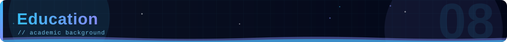

🎓 **Bachelor of Science (B.Sc.) in Computing** — Future University, Khartoum, Sudan · 2021 – 2025
🌐 Languages: Arabic, English

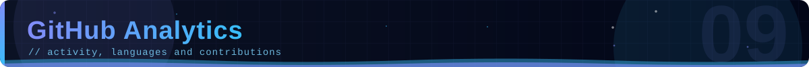

  

  

  

<picture>
  <source media="(prefers-color-scheme: dark)" srcset="https://raw.githubusercontent.com/Awab7-ux/Awab7-ux/output/github-snake-dark.svg"/>
  <source media="(prefers-color-scheme: light)" srcset="https://raw.githubusercontent.com/Awab7-ux/Awab7-ux/output/github-snake.svg"/>
  
</picture>

 

  

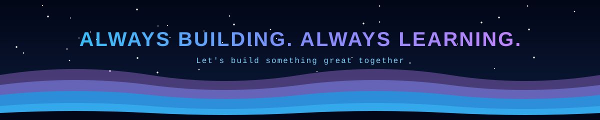
