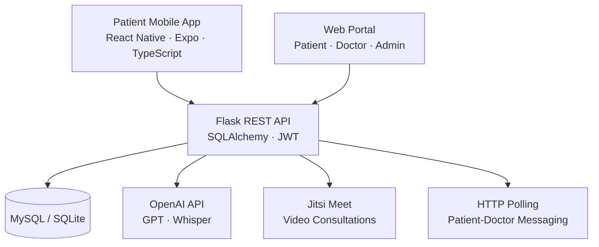
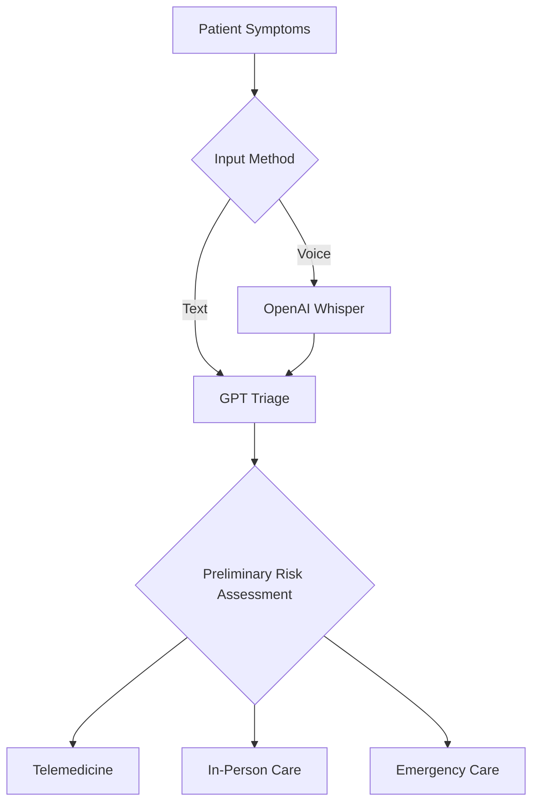
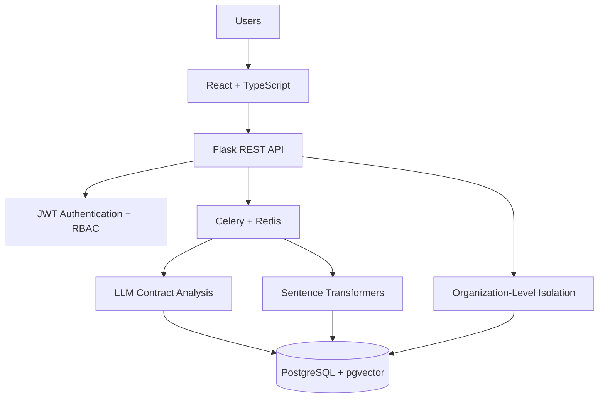
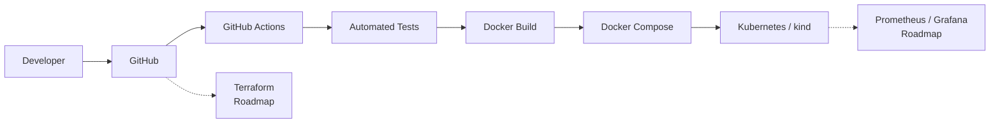
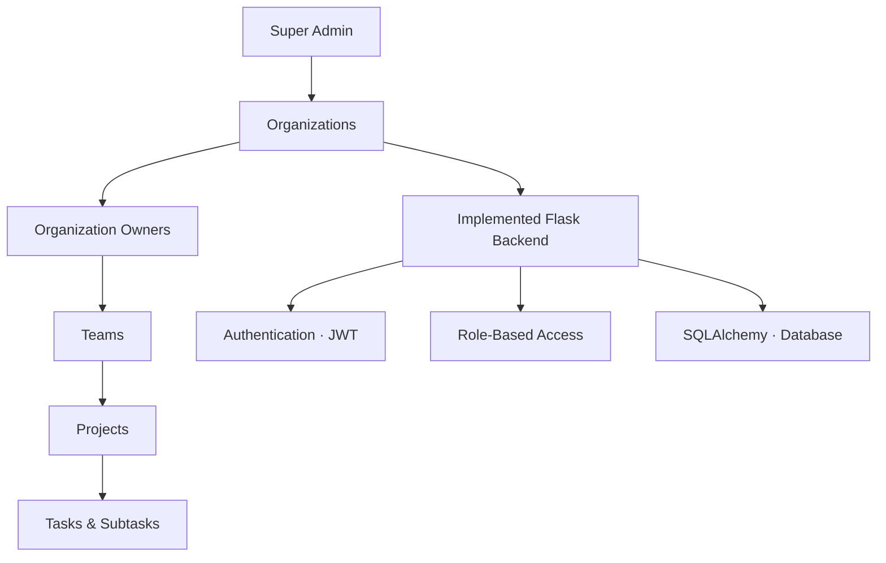

<!-- ANIMATED HERO -->
<svg xmlns="http://www.w3.org/2000/svg" viewBox="0 0 1200 320" width="1200" height="320" role="img" aria-label="Awab Imad, Full-Stack Software Engineer. AI and Backend Development. Building scalable software solutions." xmlns:c2pa="http://c2pa.org/manifest">
<title>Awab Imad - Full-Stack Software Engineer</title>
<defs>
<linearGradient id="bg" x1="0" y1="0" x2="1" y2="1"><stop offset="0" stop-color="#071426"/><stop offset="0.55" stop-color="#0A192F"/><stop offset="1" stop-color="#0B3C8C"/></linearGradient>
<linearGradient id="ac" x1="0" y1="0" x2="1" y2="0"><stop offset="0" stop-color="#2563EB"/><stop offset="1" stop-color="#06B6D4"/></linearGradient>
<radialGradient id="glow" cx="0.5" cy="0.5" r="0.5"><stop offset="0" stop-color="#38BDF8" stop-opacity="0.35"/><stop offset="1" stop-color="#38BDF8" stop-opacity="0"/></radialGradient>
<pattern id="grid" width="40" height="40" patternUnits="userSpaceOnUse"><path d="M40 0H0V40" fill="none" stroke="#38BDF8" stroke-opacity="0.08"/><animateTransform attributeName="patternTransform" type="translate" from="0 0" to="40 40" dur="8s" repeatCount="indefinite"/></pattern>
<linearGradient id="sweep" x1="0" y1="0" x2="1" y2="0"><stop offset="0" stop-color="#38BDF8" stop-opacity="0"/><stop offset="0.5" stop-color="#38BDF8" stop-opacity="0.9"/><stop offset="1" stop-color="#38BDF8" stop-opacity="0"/></linearGradient>
</defs>
<rect width="1200" height="320" rx="16" fill="url(#bg)"/>
<rect width="1200" height="320" rx="16" fill="url(#grid)"/>
<circle cx="1010" cy="150" r="170" fill="url(#glow)"><animate attributeName="r" values="150;190;150" dur="7s" repeatCount="indefinite"/></circle>
<line x1="930" y1="70" x2="1010" y2="135" stroke="#38BDF8" stroke-opacity="0.4" stroke-width="1.4" stroke-dasharray="4 6"><animate attributeName="stroke-dashoffset" values="0;-40" dur="3s" repeatCount="indefinite"/></line>
<line x1="1010" y1="135" x2="1100" y2="80" stroke="#38BDF8" stroke-opacity="0.4" stroke-width="1.4" stroke-dasharray="4 6"><animate attributeName="stroke-dashoffset" values="0;-40" dur="3s" repeatCount="indefinite"/></line>
<line x1="1010" y1="135" x2="1040" y2="215" stroke="#38BDF8" stroke-opacity="0.4" stroke-width="1.4" stroke-dasharray="4 6"><animate attributeName="stroke-dashoffset" values="0;-40" dur="3s" repeatCount="indefinite"/></line>
<line x1="1040" y1="215" x2="950" y2="190" stroke="#38BDF8" stroke-opacity="0.4" stroke-width="1.4" stroke-dasharray="4 6"><animate attributeName="stroke-dashoffset" values="0;-40" dur="3s" repeatCount="indefinite"/></line>
<line x1="950" y1="190" x2="930" y2="70" stroke="#38BDF8" stroke-opacity="0.4" stroke-width="1.4" stroke-dasharray="4 6"><animate attributeName="stroke-dashoffset" values="0;-40" dur="3s" repeatCount="indefinite"/></line>
<line x1="1040" y1="215" x2="1130" y2="190" stroke="#38BDF8" stroke-opacity="0.4" stroke-width="1.4" stroke-dasharray="4 6"><animate attributeName="stroke-dashoffset" values="0;-40" dur="3s" repeatCount="indefinite"/></line>
<line x1="950" y1="190" x2="870" y2="240" stroke="#38BDF8" stroke-opacity="0.4" stroke-width="1.4" stroke-dasharray="4 6"><animate attributeName="stroke-dashoffset" values="0;-40" dur="3s" repeatCount="indefinite"/></line>
<line x1="1040" y1="215" x2="1080" y2="260" stroke="#38BDF8" stroke-opacity="0.4" stroke-width="1.4" stroke-dasharray="4 6"><animate attributeName="stroke-dashoffset" values="0;-40" dur="3s" repeatCount="indefinite"/></line>
<line x1="1100" y1="80" x2="1130" y2="190" stroke="#38BDF8" stroke-opacity="0.4" stroke-width="1.4" stroke-dasharray="4 6"><animate attributeName="stroke-dashoffset" values="0;-40" dur="3s" repeatCount="indefinite"/></line>
<circle cx="930" cy="70" r="5.5" fill="#38BDF8"><animate attributeName="opacity" values="1;0.3;1" dur="3.00s" repeatCount="indefinite"/></circle>
<circle cx="1010" cy="135" r="5.5" fill="#38BDF8"><animate attributeName="opacity" values="1;0.3;1" dur="3.45s" repeatCount="indefinite"/></circle>
<circle cx="1100" cy="80" r="5.5" fill="#38BDF8"><animate attributeName="opacity" values="1;0.3;1" dur="3.90s" repeatCount="indefinite"/></circle>
<circle cx="1040" cy="215" r="5.5" fill="#38BDF8"><animate attributeName="opacity" values="1;0.3;1" dur="4.35s" repeatCount="indefinite"/></circle>
<circle cx="950" cy="190" r="5.5" fill="#38BDF8"><animate attributeName="opacity" values="1;0.3;1" dur="4.80s" repeatCount="indefinite"/></circle>
<circle cx="1130" cy="190" r="5.5" fill="#38BDF8"><animate attributeName="opacity" values="1;0.3;1" dur="5.25s" repeatCount="indefinite"/></circle>
<circle cx="870" cy="240" r="5.5" fill="#38BDF8"><animate attributeName="opacity" values="1;0.3;1" dur="5.70s" repeatCount="indefinite"/></circle>
<circle cx="1080" cy="260" r="5.5" fill="#38BDF8"><animate attributeName="opacity" values="1;0.3;1" dur="6.15s" repeatCount="indefinite"/></circle>
<circle r="3.5" fill="#E6F1FF"><animateMotion dur="6s" repeatCount="indefinite" path="M930 70 L1010 135 L1040 215 L950 190 Z"/></circle>
<rect x="64" y="84" width="5" height="148" rx="2.5" fill="url(#ac)"/>
<text x="90" y="132" font-family="Inter,'Segoe UI',Helvetica,Arial,sans-serif" font-size="60" font-weight="800" fill="#E6F1FF">Awab Imad</text>
<text x="90" y="176" font-family="Inter,'Segoe UI',Helvetica,Arial,sans-serif" font-size="24" font-weight="600" fill="#38BDF8">Full-Stack Software Engineer</text>
<text x="90" y="210" font-family="Inter,'Segoe UI',Helvetica,Arial,sans-serif" font-size="19" font-weight="500" fill="#CBD5E1">AI &amp; Backend Development</text>
<text x="90" y="244" font-family="Inter,'Segoe UI',Helvetica,Arial,sans-serif" font-size="16" fill="#94A3B8">Building scalable software solutions</text>
<rect x="64" y="295" width="1072" height="2" rx="1" fill="#1E3A5F"/>
<rect x="64" y="294" width="240" height="4" rx="2" fill="url(#sweep)"><animate attributeName="x" values="64;896;64" dur="6s" repeatCount="indefinite"/></rect>
<metadata><c2pa:manifest>AAAWgmp1bWIAAAAeanVtZGMycGEAEQAQgAAAqgA4m3EDYzJwYQAAABZcanVtYgAAAEdqdW1kYzJtYQARABCAAACqADibcQN1cm46YzJwYToxZTdiZTNkYS0zNTJiLTRlODgtODU3OC0zNDI1MjMzOTk1NGYAAAADl2p1bWIAAAApanVtZGMyYXMAEQAQgAAAqgA4m3EDYzJwYS5hc3NlcnRpb25zAAAAALxqdW1iAAAARGp1bWRjYm9yABEAEIAAAKoAOJtxE2MycGEuaW5ncmVkaWVudC52MwAAAAAYYzJzaO4Ue8dSV5sSq3OrISJj5HkAAABwY2JvcqNpZGM6Zm9ybWF0bWltYWdlL3N2Zyt4bWxqaW5zdGFuY2VJRHgseG1wOmlpZDo3MDJmNWU5YS1hMGUzLTRkMjEtOGRmNy00MDJmZmExNDc4MmNscmVsYXRpb25zaGlwaHBhcmVudE9mAAAB4mp1bWIAAABBanVtZGNib3IAEQAQgAAAqgA4m3ETYzJwYS5hY3Rpb25zLnYyAAAAABhjMnNoVJ6vV6PQT7ipPXFTxxaYLQAAAZljYm9yomdhY3Rpb25zgqJmYWN0aW9ua2MycGEub3BlbmVkanBhcmFtZXRlcnOha2luZ3JlZGllbnRzgaJjdXJseC1zZWxmI2p1bWJmPWMycGEuYXNzZXJ0aW9ucy9jMnBhLmluZ3JlZGllbnQudjNkaGFzaFgga0/yPj9O4tpvXd3f1WK4SB8HMizZkrEKXOFnlziQhPekZmFjdGlvbngdY29tLmFudGhyb3BpYy5jbGF1ZGUucHJvdmlkZWRqcGFyYW1ldGVyc6F4H2NvbS5hbnRocm9waWMub3JpZ2luLWNvbmZpZGVuY2VndW5rbm93bmtkZXNjcmlwdGlvbnhmQ2xhdWRlIHByb3ZpZGVkIHRoaXMgZmlsZSBhdCB0aGUgcmVxdWVzdCBvZiBhIHVzZXIgYW5kIG1heSBoYXZlIGNyZWF0ZWQgb3IgbW9kaWZpZWQgdGhlIGZpbGUgY29udGVudHMubXNvZnR3YXJlQWdlbnShZG5hbWVmQ2xhdWRlcmFsbEFjdGlvbnNJbmNsdWRlZPUAAADIanVtYgAAAEBqdW1kY2JvcgARABCAAACqADibcRNjMnBhLmhhc2guZGF0YQAAAAAYYzJzaA8u578GmuMOwj86wuVCrZYAAACAY2JvcqVjYWxnZnNoYTI1NmNwYWRMAAAAAAAAAAAAAAAAZGhhc2hYIKPO7u6zN6dqLg4aRI5hGzzoyvE70bOuMTPX5AoMdM/CZG5hbWVuanVtYmYgbWFuaWZlc3RqZXhjbHVzaW9uc4GiZXN0YXJ0GRcgZmxlbmd0aBkeBAAAAj5qdW1iAAAAJ2p1bWRjMmNsABEAEIAAAKoAOJtxA2MycGEuY2xhaW0udjIAAAACD2Nib3KlY2FsZ2ZzaGEyNTZpc2lnbmF0dXJleE1zZWxmI2p1bWJmPS9jMnBhL3VybjpjMnBhOjFlN2JlM2RhLTM1MmItNGU4OC04NTc4LTM0MjUyMzM5OTU0Zi9jMnBhLnNpZ25hdHVyZWppbnN0YW5jZUlEeCx4bXA6aWlkOmQyMTg1ZTAyLWZmODItNGQ5OS1hNWY0LWFkODlkM2U1YzMwNHJjcmVhdGVkX2Fzc2VydGlvbnODomN1cmx4LXNlbGYjanVtYmY9YzJwYS5hc3NlcnRpb25zL2MycGEuaW5ncmVkaWVudC52M2RoYXNoWCBrT/I+P07i2m9d3d/VYrhIHwcyLNmSsQpc4WeXOJCE96JjdXJseCpzZWxmI2p1bWJmPWMycGEuYXNzZXJ0aW9ucy9jMnBhLmFjdGlvbnMudjJkaGFzaFggeNswpD1WJ7WjXDkcN53NLa2n1LbAlk1KUyuFnRduPe+iY3VybHgpc2VsZiNqdW1iZj1jMnBhLmFzc2VydGlvbnMvYzJwYS5oYXNoLmRhdGFkaGFzaFgg0OBfLUtsAVCzz5GcQVxF3ngkB6vPhLkfCcOypnm5Hw90Y2xhaW1fZ2VuZXJhdG9yX2luZm+jZG5hbWVvQW50aHJvcGljIEZpbGVzZ3ZlcnNpb25lMS4wLjBrc3BlY1ZlcnNpb25lMi40LjAAABA4anVtYgAAAChqdW1kYzJjcwARABCAAACqADibcQNjMnBhLnNpZ25hdHVyZQAAABAIY2JvctKEWQISogEmGCFZAgowggIGMIIBjaADAgECAhRA5aAK7sI50L64g/oGQgU9Z1UTADAKBggqhkjOPQQDAzBJMRcwFQYDVQQKEw5BbnRocm9waWMsIFBCQzEuMCwGA1UEAxMlQW50aHJvcGljIENvbnRlbnQgQ3JlZGVudGlhbHMgUm9vdCBDQTAeFw0yNjA4MDcxODQzNTZaFw0yODA4MDYxOTQzNTZaMEQxFzAVBgNVBAoTDkFudGhyb3BpYywgUEJDMSkwJwYDVQQDEyBBbnRocm9waWMgQ2xhdWRlIENvbnRlbnQgU2lnbmluZzBZMBMGByqGSM49AgEGCCqGSM49AwEHA0IABJh6CmvLUBgFFNU0vUKlOVtE6djd17L5SuwX0LemFisBM3dkd/3cyjxFA3Qo5S46fX0/ihY0VZ7mfb9KF703t5OjWDBWMA4GA1UdDwEB/wQEAwIHgDAVBgNVHSUEDjAMBgorBgEEAYPoXgIBMAwGA1UdEwEB/wQCMAAwHwYDVR0jBBgwFoAUzlHiBIFOZFsj+OPEz5o+nMHXXMIwCgYIKoZIzj0EAwMDZwAwZAIwMXMdFJ4BetLLVY7ORuE9noqbbAZOZn/aArXyTwFAZfKrPzxF2vPoJNf1+UCdg1XGAjBwX1zd9WGqYkqmL5SFqw1QySjr1zJfpJM9+1rdDwSPLMOPOjKuiXjoU/pUUeG9RwmhY3BhZFkNngAAAAAAAAAAAAAAAAAAAAAAAAAAAAAAAAAAAAAAAAAAAAAAAAAAAAAAAAAAAAAAAAAAAAAAAAAAAAAAAAAAAAAAAAAAAAAAAAAAAAAAAAAAAAAAAAAAAAAAAAAAAAAAAAAAAAAAAAAAAAAAAAAAAAAAAAAAAAAAAAAAAAAAAAAAAAAAAAAAAAAAAAAAAAAAAAAAAAAAAAAAAAAAAAAAAAAAAAAAAAAAAAAAAAAAAAAAAAAAAAAAAAAAAAAAAAAAAAAAAAAAAAAAAAAAAAAAAAAAAAAAAAAAAAAAAAAAAAAAAAAAAAAAAAAAAAAAAAAAAAAAAAAAAAAAAAAAAAAAAAAAAAAAAAAAAAAAAAAAAAAAAAAAAAAAAAAAAAAAAAAAAAAAAAAAAAAAAAAAAAAAAAAAAAAAAAAAAAAAAAAAAAAAAAAAAAAAAAAAAAAAAAAAAAAAAAAAAAAAAAAAAAAAAAAAAAAAAAAAAAAAAAAAAAAAAAAAAAAAAAAAAAAAAAAAAAAAAAAAAAAAAAAAAAAAAAAAAAAAAAAAAAAAAAAAAAAAAAAAAAAAAAAAAAAAAAAAAAAAAAAAAAAAAAAAAAAAAAAAAAAAAAAAAAAAAAAAAAAAAAAAAAAAAAAAAAAAAAAAAAAAAAAAAAAAAAAAAAAAAAAAAAAAAAAAAAAAAAAAAAAAAAAAAAAAAAAAAAAAAAAAAAAAAAAAAAAAAAAAAAAAAAAAAAAAAAAAAAAAAAAAAAAAAAAAAAAAAAAAAAAAAAAAAAAAAAAAAAAAAAAAAAAAAAAAAAAAAAAAAAAAAAAAAAAAAAAAAAAAAAAAAAAAAAAAAAAAAAAAAAAAAAAAAAAAAAAAAAAAAAAAAAAAAAAAAAAAAAAAAAAAAAAAAAAAAAAAAAAAAAAAAAAAAAAAAAAAAAAAAAAAAAAAAAAAAAAAAAAAAAAAAAAAAAAAAAAAAAAAAAAAAAAAAAAAAAAAAAAAAAAAAAAAAAAAAAAAAAAAAAAAAAAAAAAAAAAAAAAAAAAAAAAAAAAAAAAAAAAAAAAAAAAAAAAAAAAAAAAAAAAAAAAAAAAAAAAAAAAAAAAAAAAAAAAAAAAAAAAAAAAAAAAAAAAAAAAAAAAAAAAAAAAAAAAAAAAAAAAAAAAAAAAAAAAAAAAAAAAAAAAAAAAAAAAAAAAAAAAAAAAAAAAAAAAAAAAAAAAAAAAAAAAAAAAAAAAAAAAAAAAAAAAAAAAAAAAAAAAAAAAAAAAAAAAAAAAAAAAAAAAAAAAAAAAAAAAAAAAAAAAAAAAAAAAAAAAAAAAAAAAAAAAAAAAAAAAAAAAAAAAAAAAAAAAAAAAAAAAAAAAAAAAAAAAAAAAAAAAAAAAAAAAAAAAAAAAAAAAAAAAAAAAAAAAAAAAAAAAAAAAAAAAAAAAAAAAAAAAAAAAAAAAAAAAAAAAAAAAAAAAAAAAAAAAAAAAAAAAAAAAAAAAAAAAAAAAAAAAAAAAAAAAAAAAAAAAAAAAAAAAAAAAAAAAAAAAAAAAAAAAAAAAAAAAAAAAAAAAAAAAAAAAAAAAAAAAAAAAAAAAAAAAAAAAAAAAAAAAAAAAAAAAAAAAAAAAAAAAAAAAAAAAAAAAAAAAAAAAAAAAAAAAAAAAAAAAAAAAAAAAAAAAAAAAAAAAAAAAAAAAAAAAAAAAAAAAAAAAAAAAAAAAAAAAAAAAAAAAAAAAAAAAAAAAAAAAAAAAAAAAAAAAAAAAAAAAAAAAAAAAAAAAAAAAAAAAAAAAAAAAAAAAAAAAAAAAAAAAAAAAAAAAAAAAAAAAAAAAAAAAAAAAAAAAAAAAAAAAAAAAAAAAAAAAAAAAAAAAAAAAAAAAAAAAAAAAAAAAAAAAAAAAAAAAAAAAAAAAAAAAAAAAAAAAAAAAAAAAAAAAAAAAAAAAAAAAAAAAAAAAAAAAAAAAAAAAAAAAAAAAAAAAAAAAAAAAAAAAAAAAAAAAAAAAAAAAAAAAAAAAAAAAAAAAAAAAAAAAAAAAAAAAAAAAAAAAAAAAAAAAAAAAAAAAAAAAAAAAAAAAAAAAAAAAAAAAAAAAAAAAAAAAAAAAAAAAAAAAAAAAAAAAAAAAAAAAAAAAAAAAAAAAAAAAAAAAAAAAAAAAAAAAAAAAAAAAAAAAAAAAAAAAAAAAAAAAAAAAAAAAAAAAAAAAAAAAAAAAAAAAAAAAAAAAAAAAAAAAAAAAAAAAAAAAAAAAAAAAAAAAAAAAAAAAAAAAAAAAAAAAAAAAAAAAAAAAAAAAAAAAAAAAAAAAAAAAAAAAAAAAAAAAAAAAAAAAAAAAAAAAAAAAAAAAAAAAAAAAAAAAAAAAAAAAAAAAAAAAAAAAAAAAAAAAAAAAAAAAAAAAAAAAAAAAAAAAAAAAAAAAAAAAAAAAAAAAAAAAAAAAAAAAAAAAAAAAAAAAAAAAAAAAAAAAAAAAAAAAAAAAAAAAAAAAAAAAAAAAAAAAAAAAAAAAAAAAAAAAAAAAAAAAAAAAAAAAAAAAAAAAAAAAAAAAAAAAAAAAAAAAAAAAAAAAAAAAAAAAAAAAAAAAAAAAAAAAAAAAAAAAAAAAAAAAAAAAAAAAAAAAAAAAAAAAAAAAAAAAAAAAAAAAAAAAAAAAAAAAAAAAAAAAAAAAAAAAAAAAAAAAAAAAAAAAAAAAAAAAAAAAAAAAAAAAAAAAAAAAAAAAAAAAAAAAAAAAAAAAAAAAAAAAAAAAAAAAAAAAAAAAAAAAAAAAAAAAAAAAAAAAAAAAAAAAAAAAAAAAAAAAAAAAAAAAAAAAAAAAAAAAAAAAAAAAAAAAAAAAAAAAAAAAAAAAAAAAAAAAAAAAAAAAAAAAAAAAAAAAAAAAAAAAAAAAAAAAAAAAAAAAAAAAAAAAAAAAAAAAAAAAAAAAAAAAAAAAAAAAAAAAAAAAAAAAAAAAAAAAAAAAAAAAAAAAAAAAAAAAAAAAAAAAAAAAAAAAAAAAAAAAAAAAAAAAAAAAAAAAAAAAAAAAAAAAAAAAAAAAAAAAAAAAAAAAAAAAAAAAAAAAAAAAAAAAAAAAAAAAAAAAAAAAAAAAAAAAAAAAAAAAAAAAAAAAAAAAAAAAAAAAAAAAAAAAAAAAAAAAAAAAAAAAAAAAAAAAAAAAAAAAAAAAAAAAAAAAAAAAAAAAAAAAAAAAAAAAAAAAAAAAAAAAAAAAAAAAAAAAAAAAAAAAAAAAAAAAAAAAAAAAAAAAAAAAAAAAAAAAAAAAAAAAAAAAAAAAAAAAAAAAAAAAAAAAAAAAAAAAAAAAAAAAAAAAAAAAAAAAAAAAAAAAAAAAAAAAAAAAAAAAAAAAAAAAAAAAAAAAAAAAAAAAAAAAAAAAAAAAAAAAAAAAAAAAAAAAAAAAAAAAAAAAAAAAAAAAAAAAAAAAAAAAAAAAAAAAAAAAAAAAAAAAAAAAAAAAAAAAAAAAAAAAAAAAAAAAAAAAAAAAAAAAAAAAAAAAAAAAAAAAAAAAAAAAAAAAAAAAAAAAAAAAAAAAAAAAAAAAAAAAAAAAAAAAAAAAAAAAAAAAAAAAAAAAAAAAAAAAAAAAAAAAAAAAAAAAAAAAAAAAAAAAAAAAAAAAAAAAAAAAAAAAAAAAAAAAAAAAAAAAAAAAAAAAAAAAAAAAAAAAAAAAAAAAAAAAAAAAAAAAAAAAAAAAAAAAAAAAAAAAAAAAAAAAAAAAAAAAAAAAAAAAAAAAAAAAAAAAAAAAAAAAAAAAAAAAAAAAAAAAAAAAAAAAAAAAAAAAAAAAAAAAAAAAAAAAAAAAAAAAAAAAAAAAAAAAAAAAAAAAAAAAAAAAAAAAAAAAAAAAAAAAAAAAAAAAAAAAAAAAAAAAAAAAAAAAAAAAAAAAAAAAAAAAAAAAAAAAAAAAAAAAAAAAAAAAAAAAAAAAAAAAAAAAAAAAAAAAAAAAAAAAAAAAAAAAAAAAAAAAAAAAAAAAAAAAAAAAAAAAAAAAAAAAAAAAAAAAAAAAAAAAAAAAAAAAAAAAAAAAAAAAAAAAAAAAAAAAAAAAAAAAAAAAAAAAAAAAAAAAAAAAAAAAAAAAAAAAAAAAAAAAAAAAAAAAAAAAAAAAAAAAAAAAAAAAAAAAAAAAAAAAAAAAAAAAAAAAAAAAAAAAAAAAAAAAAAAAAAAAAAAAAAAAAAAAAAAAAAAAAAAAAAAAAAAAAAAAAAAAAAAAAAAAAAAAAAAAAAAAAAAAAAAAAAAAAAAAAAAAAAAAAAAAAAAAAAAAAAAAAAAAAAAAAAAAAAAAAAAAAAAAAAAAAAAAAAAAAAAAAAAAAAAAAAAAAAAAAAAAAAAAAAAAAAAAAAAAAAAAAAAAAAAAAAAAAAAAAAAAAAAAAAAAAAAAAAAAAAAAAAAAAAAAAAAAAAAAAAAAAAAAAAAAAAAAAAAAAAAAAAAAAAAAAAAAAAAAAAAAAAAAAAAAAAAAAAAAAAAAAAAAAAAAAAAAAAAAAAAAAAAAAAAAAAAAAAAAAAAAAAAAAAAAAAAAAAAAAAAAAAAAAAAAAAAAAAAAAAAAAAAAAAAAAAAAAAAAAAAAAAAAAAAAAAAAAAAAAAAAAAAAAAAAAAAAAAAAAAAAAAAAAAAAAAAAAAAAAAAAAAAAAAAAAAAAAAAAAAAAAAAAAAAAAAAAAAAAAAAAAAAAAAAAAAAAAAAAAAAAAAAAAAPZYQLj0nRYD2KP9PwNQ3Kt2ohj6gDTHwUH+7PjssRxNjqSk8PPNmlRoIstPE517f7rBabt3Vaa20yFUzWMdjpHJ9LE=</c2pa:manifest></metadata></svg>

 

  

**AI-Integrated Systems · Backend Engineering · Full-Stack Development · Cloud & DevOps**

Building reliable software. Engineering practical solutions. Learning continuously.

---

## 01. About Me

I'm a Computer Science graduate and Software Engineer interested in designing and building complete software systems, from backend architecture and REST APIs to modern web and mobile applications.

My work focuses on combining solid software engineering practices with practical AI integration to solve real-world problems.

**What I enjoy engineering:**

- Backend systems, RESTful APIs and scalable application architectures.
- Multi-tenant SaaS platforms, authentication and role-based access control.
- AI-powered applications, LLM integration and intelligent workflows.
- React and React Native applications with bilingual interfaces.
- Containerization, CI/CD pipelines and cloud infrastructure.

**Currently focused on:** AI engineering, distributed application architecture, Cloud and DevOps.

Open to Software Engineer, Backend Engineer, Full-Stack Developer and AI Engineer opportunities, as well as meaningful engineering collaborations.

---

## 02. Featured Engineering Projects

### 🏥 Sahatak (صحتك) — Integrated Telemedicine Platform

**Connecting patients, doctors and healthcare services through technology.**

Sahatak is a bilingual digital healthcare platform designed to improve access to medical services through remote consultations, appointment booking, medical records and AI-assisted preliminary symptom assessment.

The engineering challenge involves coordinating mobile and web clients with a shared backend and external services.

**System Architecture**

**Core capabilities**

| Area | Features |
|---|---|
| Patient experience | Registration, profiles, doctor discovery and appointment booking |
| Medical records | Health records, care summaries and prescriptions |
| Consultations | Jitsi Meet video consultations |
| Communication | Patient-doctor messaging, notifications and file sharing |
| AI integration | Preliminary symptom assessment and voice transcription |
| Healthcare services | Pharmacy, clinic locator and checkup packages |
| Accessibility | Arabic / English, RTL support and Calm Mode |

**Project components**

- [Patient Mobile App](https://github.com/Awab7-ux/Sahatak-Telemedicine-App2/tree/main/sahatak-mobile) — React Native, Expo and TypeScript.
- [Web Portal & Team Backend](https://github.com/sahataksudan-collab/Sahatak) — HTML, JavaScript, Bootstrap and Flask.
- [Companion Repository](https://github.com/Awab7-ux/Sahatak-Telemedicine-App2) — companion backend and web implementation.

**AI Symptom Assessment Workflow**

Voice input is transcribed through Whisper and processed using a language-aware GPT prompt. The system provides preliminary guidance, not a professional medical diagnosis.

**Engineering highlights**

- 3 coordinated application components.
- 56 historical registered users.
- 50+ historical AI symptom-assessment queries.
- JWT authentication and Jitsi integration.
- HTTP Polling instead of WebSockets for messaging.

Figures are historical project metrics, not live counters. The mobile APK has not been publicly released.

---

### ⚖️ Lexera — AI Contract Intelligence SaaS

Lexera is a multi-tenant SaaS platform designed to simplify legal contract management through AI-powered risk analysis, semantic search and automated renewal alerts.

**Architecture**

**Key engineering features**

- Multi-tenant architecture with organization-scoped data isolation.
- JWT authentication and role-based permissions.
- AI-assisted contract risk analysis and missing-clause detection.
- Semantic search using PostgreSQL and pgvector.
- Local sentence-transformer embeddings to reduce external API costs.
- Background processing using Celery and Redis.
- Speech-to-text voice notes and renewal alerts.

**Technology stack**

**Deployment:** Railway · Neon · Upstash · Vercel

---

### ☁️ CloudOps — Cloud Infrastructure & Deployment Platform

Active Development

A cloud infrastructure and deployment management platform built to explore production-style DevOps workflows through a FastAPI backend and React dashboard.

**Delivery Pipeline**

**Implemented engineering components**

- FastAPI backend with layered architecture.
- React and TypeScript dashboard.
- Docker images and Docker Compose.
- Nginx frontend serving.
- GitHub Actions CI workflows.
- Kubernetes manifests for local kind.
- Approximately 240 pytest test functions.

**Technology stack**

**Current limitations:** SQLite database, no authentication yet, and some dashboard pages use labeled demo data.

**Roadmap:** Terraform, Prometheus and Grafana monitoring.

---

### 📊 PMS — Project Management System

Active Development

A multi-tenant project management SaaS platform inspired by Jira, Asana and Trello, designed to help organizations manage teams, projects and collaborative workflows.

**System hierarchy**

**Backend foundation**

- Flask application factory.
- SQLAlchemy and database migrations.
- Authentication and authorization.
- Organizations, teams and user management.
- UUID-based user identification.
- Role-based access control.

**Technology stack**

The project is in progress. Some product modules and UI features remain planned or prototyped.

---

## 03. Other Engineering Projects

| Project | Description | Technologies |
|---|---|---|
| [Accounts](https://github.com/Awab7-ux/accounts) | Accounts REST service, CI and security headers | Python, Docker |
| [Tax Calculator DevOps](https://github.com/Awab7-ux/tax-calculator-devops-capstone) | Tested tax service and Kubernetes manifests | Flask, Docker, Kubernetes |
| [CI/CD Final Project](https://github.com/Awab7-ux/ci-cd-final-project) | Automated testing and container builds | Node.js, Docker |
| [Full-Stack Capstone](https://github.com/Awab7-ux/xrwvm-fullstack_developer_capstone) | Full-stack application and deployment configuration | Django, Docker |
| [Online Course](https://github.com/Awab7-ux/onlinecourse-final-project) | Online learning platform with assessments | Django |
| [Backend Development Capstone](https://github.com/Awab7-ux/Back-end-Development-Capstone) | Concert website backend | Django |
| [Medical Appointment](https://github.com/Awab7-ux/med_appt) | Doctor appointment booking frontend | JavaScript, HTML, CSS |

---

## 04. Technical Skills

### Programming Languages

### Backend Engineering

SQLAlchemy · REST APIs · JWT · RBAC · Celery · Layered Architecture

### Frontend & Mobile Development

React Native · Expo · TypeScript · Responsive Design · RTL Interfaces

### Databases & Data Engineering

SQL · pgvector · Database Migrations · Tenant Isolation

### AI Engineering

OpenAI API · Whisper · Groq-hosted LLMs · Sentence Transformers · Embeddings · Semantic Search · AI Workflows

### Cloud & DevOps

Docker Compose · CI/CD · GitHub Actions · Kubernetes · Nginx

### Development Tools

pytest · API Testing · Git Workflows · Automated Testing

---

## 05. Engineering Principles

| Principle | My Approach |
|---|---|
| Security First | Keep secrets server-side and enforce authorization at API boundaries. |
| Tenant Isolation | Scope organization data at every query and test isolation boundaries. |
| Maintainable Architecture | Separate routers, services, repositories and schemas. |
| Reliable Delivery | Use automated tests, CI workflows and containerized environments. |
| Practical AI | Integrate AI into real workflows with clear limitations and safeguards. |
| Engineering Transparency | Clearly distinguish implemented features from prototypes and roadmap items. |

---

## 06. Certifications

  

  

Verify credentials through the linked Credly pages. These are professional certificates and course-completion credentials, not proctored vendor certification exams.

---

## 07. GitHub Analytics

  

  

  

  

### Contribution Activity

<picture>
  <source media="(prefers-color-scheme: dark)" srcset="https://raw.githubusercontent.com/Awab7-ux/Awab7-ux/output/github-snake-dark.svg"/>
  <source media="(prefers-color-scheme: light)" srcset="https://raw.githubusercontent.com/Awab7-ux/Awab7-ux/output/github-snake.svg"/>
  
</picture>

---

## 08. Let's Connect

**I build software that solves problems, connects systems and creates meaningful impact.**

I'm open to engineering opportunities, technical discussions and collaborations on innovative software projects.

 

  

Designed and engineered by Awab Imad · Always building. Always learning.

